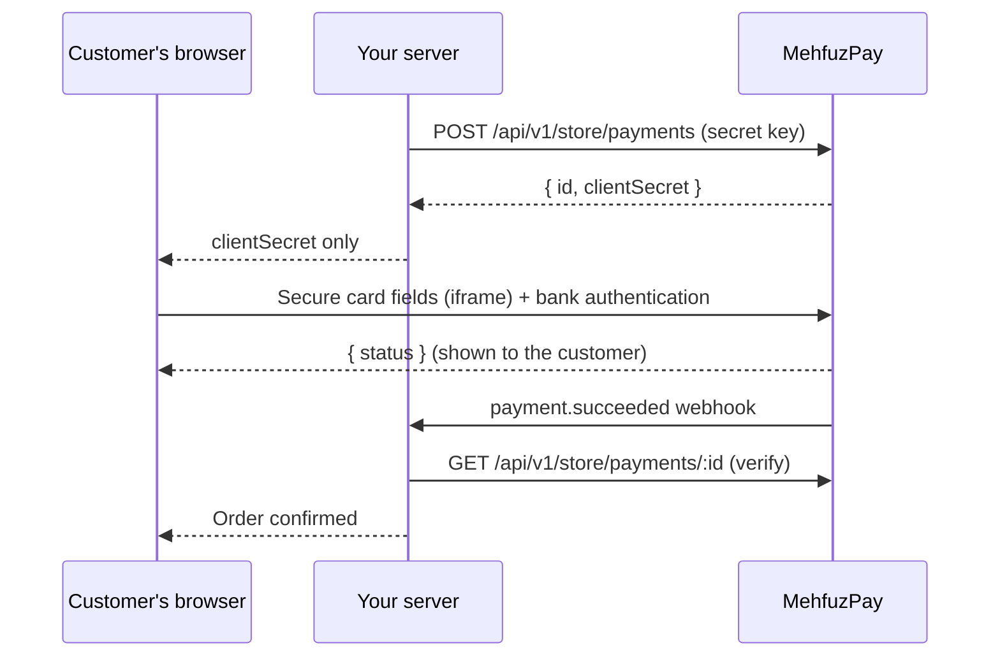

# @mehfuzpay/js

**Secure card fields for your own checkout page — card data never touches your website or your server.**

`@mehfuzpay/js` lets Pakistani businesses accept card payments through [MehfuzPay](https://mehfuzpay.com)
on a checkout page they design themselves. The card number, expiry and CVV are typed into a secure
MehfuzPay frame and go straight to the payment processor. Your page only receives the payment
status, so you never see, store or log card data.

> **Status: sandbox preview (0.1.x).** Only test payments are supported right now. No real money
> moves. Live payments will be enabled per merchant after MehfuzPay approval.

- [Why use it](#why-use-it)
- [How it works](#how-it-works)
- [Before you start](#before-you-start)
- [Install](#install)
- [Quick start](#quick-start)
- [Framework guides](#framework-guides)
- [Webhooks](#webhooks)
- [API reference](#api-reference)
- [Testing in the sandbox](#testing-in-the-sandbox)
- [Security checklist](#security-checklist)
- [Troubleshooting](#troubleshooting)
- [Support](#support)

## Why use it

| | Hosted checkout | `@mehfuzpay/js` |
|---|---|---|
| Who designs the payment page | MehfuzPay | **You** |
| Customer leaves your site | Yes (redirect) | **No** |
| Card data reaches your page/server | No | **No** |
| Bank authentication (3-D Secure) | On MehfuzPay | Inside the card fields on your page |

If you don't need a custom design, the [hosted checkout](https://mehfuzpay.com/docs?topic=hosted-checkout)
is simpler: send the customer to `checkoutUrl` and you're done.

## How it works



1. **Your server** creates a payment with your secret API key and receives a `clientSecret`.
2. **Your page** shows the MehfuzPay card fields using that `clientSecret`.
3. The customer pays. If the bank asks for authentication, it appears inside the card fields.
4. **Your server** confirms the final status (API or webhook) before fulfilling the order.

## Before you start

- A MehfuzPay merchant account — [sign up](https://mehfuzpay.com/signup).
- A **sandbox API key** from *Dashboard → API keys*. It starts with `mp_test_`, is shown only once
  and expires on the date you choose.
- Optional: set an IP allow-list for the key in the dashboard.
- Your checkout page must be served over **HTTPS** (`http://localhost` is fine while developing).
- Amounts are in **paisa** (`250000` = PKR 2,500.00). Currency is `PKR`.

## Install

```bash
npm install @mehfuzpay/js
```

Also works with `yarn add @mehfuzpay/js` and `pnpm add @mehfuzpay/js`. It is an ES module with
TypeScript types and no dependencies.

Without a build tool, load it from a CDN:

```html
<script type="module">
  import { loadMehfuzPay } from 'https://esm.sh/@mehfuzpay/js@0.1';
</script>
```

## Quick start

### 1. Server — create the payment

Keep your API key on the server. MehfuzPay rejects requests that come from a browser.

**Node.js (18+)**

```js
import express from 'express';
import { randomUUID } from 'node:crypto';

const app = express();
app.use(express.json());

app.post('/checkout/payment', async (req, res) => {
  const order = await loadOrderFromYourDatabase(req); // your code: amount, customer details
  const response = await fetch('https://mehfuzpay.com/api/v1/store/payments', {
    method: 'POST',
    headers: {
      Authorization: `Bearer ${process.env.MEHFUZPAY_SECRET_KEY}`,
      'Content-Type': 'application/json'
    },
    body: JSON.stringify({
      orderReference: order.reference, // unique per payment attempt (e.g. ORDER-1001, ORDER-1001-2)
      idempotencyKey: order.idempotencyKey ?? randomUUID(), // store it; reuse it on retries
      amountPaisa: order.totalPaisa,
      currency: 'PKR',
      environment: 'sandbox',
      method: 'card',
      returnUrl: 'https://your-shop.pk/thank-you',
      cancelUrl: 'https://your-shop.pk/cart',
      payer: {
        firstName: order.firstName,
        lastName: order.lastName,
        email: order.email,
        phone: order.phone // +92XXXXXXXXXX
      }
    })
  });
  const payment = await response.json();
  if (!response.ok) return res.status(502).json({ error: payment.error });
  await savePaymentIdOnOrder(order, payment.id); // your code
  res.json({ clientSecret: payment.clientSecret }); // send ONLY the clientSecret
});
```

**PHP**

```php
<?php
$payload = [
  'orderReference' => $order['reference'],
  'idempotencyKey' => $order['idempotency_key'], // 16-100 chars: letters, numbers, _ or -
  'amountPaisa'    => $order['total_paisa'],
  'currency'       => 'PKR',
  'environment'    => 'sandbox',
  'method'         => 'card',
  'returnUrl'      => 'https://your-shop.pk/thank-you',
  'cancelUrl'      => 'https://your-shop.pk/cart',
  'payer'          => [
    'firstName' => $order['first_name'], 'lastName' => $order['last_name'],
    'email' => $order['email'], 'phone' => $order['phone'],
  ],
];
$ch = curl_init('https://mehfuzpay.com/api/v1/store/payments');
curl_setopt_array($ch, [
  CURLOPT_POST => true,
  CURLOPT_RETURNTRANSFER => true,
  CURLOPT_HTTPHEADER => [
    'Authorization: Bearer ' . getenv('MEHFUZPAY_SECRET_KEY'),
    'Content-Type: application/json',
  ],
  CURLOPT_POSTFIELDS => json_encode($payload),
]);
$payment = json_decode(curl_exec($ch), true);
// Save $payment['id'] on the order, then return only the client secret:
header('Content-Type: application/json');
echo json_encode(['clientSecret' => $payment['clientSecret']]);
```

**Python (requests)**

```python
import os, requests

payment = requests.post(
    "https://mehfuzpay.com/api/v1/store/payments",
    headers={"Authorization": f"Bearer {os.environ['MEHFUZPAY_SECRET_KEY']}"},
    json={
        "orderReference": order.reference,
        "idempotencyKey": order.idempotency_key,
        "amountPaisa": order.total_paisa,
        "currency": "PKR",
        "environment": "sandbox",
        "method": "card",
        "returnUrl": "https://your-shop.pk/thank-you",
        "cancelUrl": "https://your-shop.pk/cart",
        "payer": {"firstName": order.first_name, "lastName": order.last_name,
                  "email": order.email, "phone": order.phone},
    },
    timeout=30,
).json()
# Save payment["id"] on the order; return only payment["clientSecret"] to the browser.
```

The response looks like this:

```json
{
  "id": "6f1c2b0e-8a7d-4c3e-9b1a-2d4e6f8a0b1c",
  "orderReference": "ORDER-1001",
  "amountPaisa": 250000,
  "currency": "PKR",
  "environment": "sandbox",
  "status": "checkout_ready",
  "checkoutUrl": "https://mehfuzpay.com/checkout/6f1c...#token=...",
  "clientSecret": "6f1c2b0e-8a7d-4c3e-9b1a-2d4e6f8a0b1c_secret_..."
}
```

### 2. Browser — show the card fields

```html
<form id="payment-form">
  <div id="card"></div>
  <input id="line1" placeholder="Billing address" required />
  <input id="city" placeholder="City" required />
  <button id="pay" disabled>Pay PKR 2,500</button>
  <p id="message" role="alert"></p>
</form>
```

```js
import { loadMehfuzPay } from '@mehfuzpay/js';

const { clientSecret } = await fetch('/checkout/payment', { method: 'POST' }).then((r) => r.json());

const mehfuzpay = loadMehfuzPay();
const card = mehfuzpay.createCardElement({
  clientSecret,
  appearance: { fontFamily: 'Inter, sans-serif', fontSize: '16px', color: '#111827' }
});
card.mount('#card');
card.on('ready', () => (pay.disabled = false));
card.on('error', ({ message }) => (document.getElementById('message').textContent = message));

document.getElementById('payment-form').addEventListener('submit', async (event) => {
  event.preventDefault();
  pay.disabled = true;
  const result = await card.confirmPayment({
    billing: {
      line1: document.getElementById('line1').value,
      city: document.getElementById('city').value,
      country: 'PK'
    }
  });
  if (result.error) {
    // e.g. invalid_card — the customer can correct the card and try again
    document.getElementById('message').textContent = result.error.message;
    pay.disabled = false;
    return;
  }
  // 'succeeded', 'failed' or 'processing'. Let your server decide what the customer sees.
  location.href = `/orders/status?payment=${result.paymentId}`;
});
```

### 3. Server — verify before you fulfil

Anyone can fake a result in the browser. Only trust what your server reads from MehfuzPay:

```js
const res = await fetch(`https://mehfuzpay.com/api/v1/store/payments/${paymentId}`, {
  headers: { Authorization: `Bearer ${process.env.MEHFUZPAY_SECRET_KEY}` }
});
const payment = await res.json();
// Check payment.orderReference, payment.amountPaisa and payment.currency against your order,
// then fulfil once — and only when payment.status === 'succeeded'.
```

| Server status | Meaning | What to do |
|---|---|---|
| `checkout_ready` | Waiting for the customer | Show the card fields |
| `unknown` | Submitted, confirmation pending | Wait for the webhook or check again. **Do not charge again.** |
| `succeeded` | Paid (provider-confirmed) | Fulfil the order once |
| `failed` | Declined | Let the customer try again with a new payment (new `orderReference` and `idempotencyKey`) |
| `review_required` | Needs manual review | Hold the order and contact MehfuzPay support |

## Framework guides

### React

```jsx
import { useEffect, useRef, useState } from 'react';
import { loadMehfuzPay } from '@mehfuzpay/js';

const mehfuzpay = loadMehfuzPay(); // create once, outside components

export default function CardPayment({ clientSecret, billing, onDone }) {
  const container = useRef(null);
  const card = useRef(null);
  const [ready, setReady] = useState(false);
  const [error, setError] = useState('');

  useEffect(() => {
    const element = mehfuzpay.createCardElement({ clientSecret }).mount(container.current);
    element.on('ready', () => setReady(true));
    element.on('error', (e) => setError(e.message));
    card.current = element;
    return () => element.destroy();
  }, [clientSecret]);

  async function pay() {
    setReady(false);
    const result = await card.current.confirmPayment({ billing });
    if (result.error) {
      setError(result.error.message);
      setReady(true);
    } else onDone(result);
  }

  return (
    <>
      <div ref={container} />
      {error && <p role="alert">{error}</p>}
      <button disabled={!ready} onClick={pay}>Pay</button>
    </>
  );
}
```

### Next.js

Use the React component above in a client component (`'use client'` at the top of the file) and
create the payment in a Route Handler or Server Action, so the secret key stays on the server.
Never prefix the key with `NEXT_PUBLIC_`.

### Vue 3

```vue
<script setup>
import { onMounted, onBeforeUnmount, ref } from 'vue';
import { loadMehfuzPay } from '@mehfuzpay/js';

const props = defineProps({ clientSecret: String });
const el = ref(null);
let card;
onMounted(() => (card = loadMehfuzPay().createCardElement({ clientSecret: props.clientSecret }).mount(el.value)));
onBeforeUnmount(() => card?.destroy());
</script>

<template><div ref="el" /></template>
```

## Webhooks

Add an endpoint in *Dashboard → Webhooks & deliveries* (HTTPS, public address) and subscribe to `payment.succeeded`,
`payment.failed` and `payment.review_required`. MehfuzPay sends:

```http
POST /your/webhook
Content-Type: application/json
X-MehfoozPay-Event: 0b5c...            (unique event id)
X-MehfoozPay-Signature: t=1792364882,v1=5f2c...

{"id":"0b5c...","type":"payment.succeeded","resourceId":"<payment id>","createdAt":"2026-10-19T10:00:00.000Z"}
```

Verify the signature with the endpoint's signing secret, then re-read the payment from the API:

```js
import { createHmac, timingSafeEqual } from 'node:crypto';

// Use the RAW request body, e.g. express.raw({ type: 'application/json' })
export function verifyMehfuzPayWebhook(rawBody, header, secret) {
  const parts = Object.fromEntries(header.split(',').map((p) => p.split('=')));
  if (!parts.t || !parts.v1) return false;
  if (Math.abs(Date.now() / 1000 - Number(parts.t)) > 300) return false; // 5 minute window
  const expected = createHmac('sha256', secret).update(`${parts.t}.${rawBody}`).digest('hex');
  return expected.length === parts.v1.length && timingSafeEqual(Buffer.from(expected), Buffer.from(parts.v1));
}
```

Webhooks can arrive more than once. Fulfil each order only once. Failed deliveries are retried and
can be re-sent from the dashboard.

## API reference

### `loadMehfuzPay(options?)`

Returns a `MehfuzPay` instance. Create it once per page.

| Option | Default | Description |
|---|---|---|
| `baseUrl` | `https://mehfuzpay.com` | Only change this for local development against a MehfuzPay dev server. |

Throws `MehfuzPayError` with code `insecure_page` on non-HTTPS pages (except `localhost`).

### `mehfuzpay.createCardElement(options)`

| Option | Required | Description |
|---|---|---|
| `clientSecret` | Yes | From your server. Opens card entry for that one order; expires after one hour. |
| `appearance.fontFamily` | No | e.g. `"Inter, sans-serif"` |
| `appearance.fontSize` | No | `10px`–`24px`, e.g. `"16px"` |
| `appearance.color` | No | Hex text colour, e.g. `"#111827"` |

### `card.mount(target)`

Inserts the secure frame into an element or CSS selector. The frame resizes itself, including when
bank authentication is shown. On narrow screens the card row scrolls sideways to reveal expiry and CVV.

### `card.on(event, handler)`

Returns a function that removes the handler.

| Event | Payload | When |
|---|---|---|
| `ready` | `{ paymentId }` | Card fields can be used. Enable your pay button here. |
| `error` | `{ code, message }` | The fields could not load: `expired` or `unavailable`. Create a new payment. |
| `status` | `{ paymentId, status }` | The payment was no longer open for card entry (e.g. already submitted). |
| `authentication` | `{ active }` | Bank authentication opened (`true`) or closed (`false`). |

### `card.confirmPayment({ billing })`

Validates the card, submits the payment once and handles bank authentication.
Resolves to **either** `{ paymentId, status }` **or** `{ paymentId, error }` — it never rejects for
payment outcomes.

`billing`: `{ line1, city, postalCode?, country? }` — `line1` and `city` are required; `country`
must be `"PK"` (default).

| `status` | Meaning |
|---|---|
| `succeeded` | MehfuzPay received the provider's signed confirmation. |
| `failed` | The payment was declined. |
| `processing` | Submitted, confirmation not received yet. Verify on your server; do not charge again. |

| `error.code` | Meaning | Customer can retry? |
|---|---|---|
| `invalid_card` | Card details incomplete or invalid | Yes |
| `card_entry_failed` | Secure entry failed before submission. No payment was made. | Yes |
| `not_ready` | Called before the `ready` event | Yes |
| `in_progress` | A confirmation is already running | Wait |
| `already_submitted` | This payment was already submitted | No — check status |
| `invalid_billing` | Billing details missing or invalid | Yes |
| `not_mounted` | `mount()` was not called | — |

Throws `MehfuzPayError` (`card_data_not_allowed`) if a billing field contains a card number.

### `card.destroy()`

Removes the frame and listeners. If a confirmation was running it resolves as `processing`.

### TypeScript

Types are included: `MehfuzPay`, `CardElement`, `ConfirmPaymentResult`, `BillingDetails`,
`MehfuzPayError` and more.

## Testing in the sandbox

Use your `mp_test_` key and `environment: 'sandbox'`. Sandbox test card:

| Card number | Expiry | CVV | Result |
|---|---|---|---|
| `4456 5300 0000 1005` | any future date | `123` | Frictionless authentication |

Never use a real card in the sandbox.

## Security checklist

- [ ] The secret key is only on your server (environment variable, never in browser code or Git).
- [ ] Your page sends only `clientSecret` to the browser. Don't log it or put it in URLs.
- [ ] You never build your own card inputs and never ask customers for card numbers by email,
      chat or forms. **The MehfuzPay API rejects any request containing a card number.**
- [ ] You fulfil orders only after your server sees `succeeded` (API or verified webhook),
      and only once.
- [ ] If your site uses a Content Security Policy, allow the frame:
      `frame-src https://mehfuzpay.com;`
- [ ] Each order payment is submitted once. For `processing` or `unknown`, wait — never retry the
      charge blindly.

## Troubleshooting

| Problem | Fix |
|---|---|
| `invalid_client_secret` | Pass the `clientSecret` from the create-payment response, not the payment id or your API key. |
| `insecure_page` | Serve the checkout over HTTPS (or `localhost` while developing). |
| Card fields never appear | Allow `frame-src https://mehfuzpay.com` in your CSP; check ad/script blockers. |
| `error` event with `expired` | The client secret is older than one hour. Create a new payment for the order. |
| 401 from the API | Wrong or revoked key, or a browser request. Call the API from your server. |
| 403 from the API | Your server's IP is not in the key's allow-list, or a live key was used in the sandbox. |
| 400 "Card numbers are not accepted" | Something in your request (name, reference, notes) contains a card number. Remove it. |
| Result `processing` | Normal when confirmation is still on its way. Wait for the webhook or check the payment again. |

## Browser support

Current versions of Chrome, Edge, Firefox and Safari (desktop and mobile).

## Support

- Documentation: <https://mehfuzpay.com/docs?topic=custom-checkout>
- Email: [business@mehfuzpay.com](mailto:business@mehfuzpay.com)
- Bugs and questions about this package: open an issue in this repository.
- Security issues: see [SECURITY.md](SECURITY.md). Please don't open a public issue.

## License

[MIT](LICENSE) © Orqentra SMC Limited (MehfuzPay)
